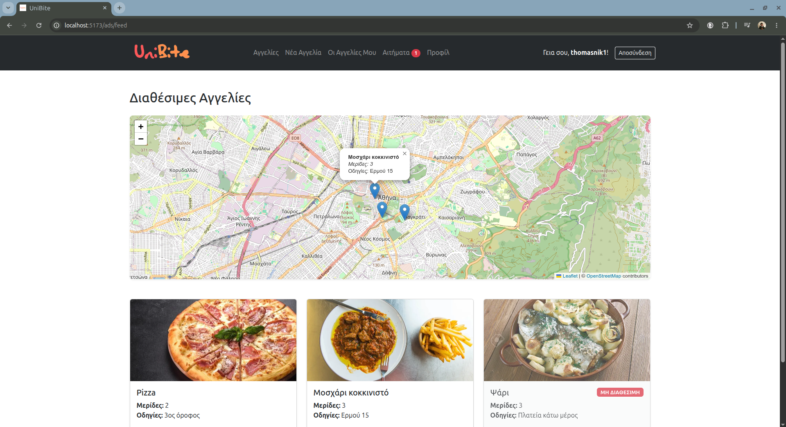
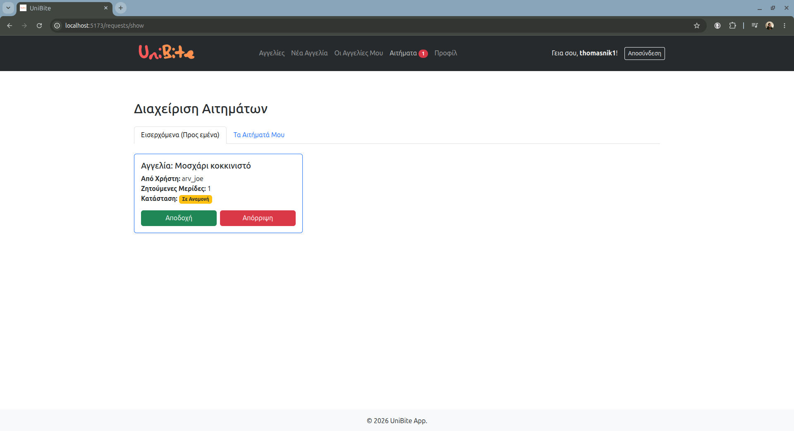
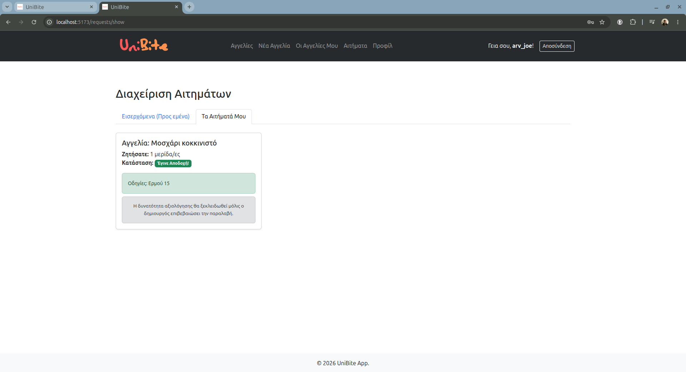
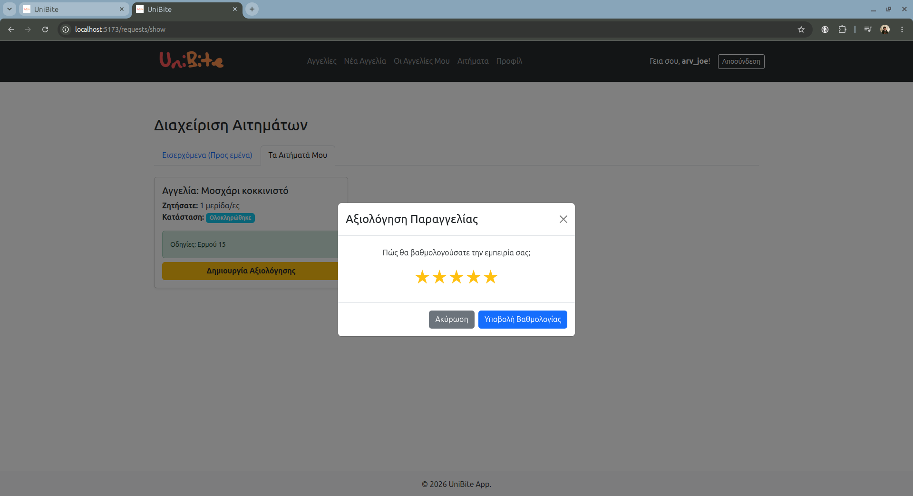
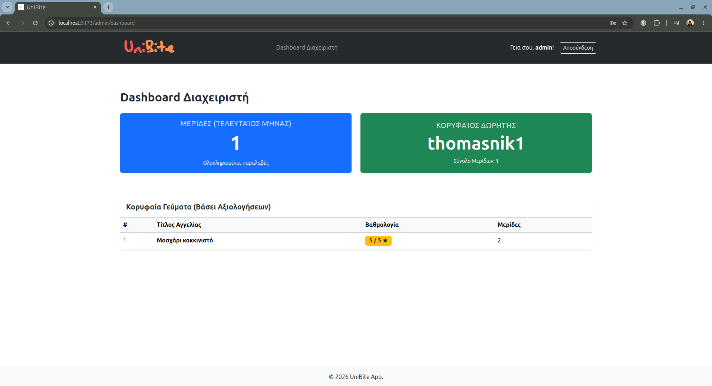

# UniBite


A web platform that aims to help students share food within the academic community. UniBite was developed as part of the "Web Programming and Systems" course at the Computer Engineering and Informatics Department (CEID), University of Patras.

## Table of Contents
- [Project Description](#project-description)
- [Key Features](#key-features)
- [Screenshots](#screenshots)
- [Tech Stack](tech-stack)
- [Getting Started](getting-started)
- [Installation](#installation)

## Project Description
Developing UniBite provides students with their first hands-on experience in web development. The focus of this project is to create a web platform for food sharing that's used by the academic community. The idea behind UniBite is that students can cook large portions of food, keep some for themselves, and share the rest with other students, users of UniBite. With each portion the users give out, they earn back points that they can use to claim food from other users.

## Key Features
- **User Authentication**: Secure signup and login using JWT.
- **Food Sharing Ads**: Users can create, view, and manage ads for available food portions.
- **Request System**: Users can request portions, while cooks can approve or reject them.
- **Rating & Penalties**: A 5-star rating system for completed meals and a penalty system for no-shows.
- **Admin Dashboard**: Dedicated panel for admins to monitor platform statistics (e.g., total portions shared, top donors).
- **Interactive Maps**: View available food ads on a map based on location.

## Screenshots

<p align="center">
  
  
  
  
  
</p>

## Tech Stack
### DevOps

**Docker & Docker Compose** were used to initialize Node.js and MySQL database containers.

### Backend
- **Node.js** along with **Express** provides the RESTful API backend.
- **MySQL** relational database for platform data.
- **Sequelize ORM** handles the database and models.
- **JWT(JSON Web Tokens)** manages user authentication.
- **Joi** validates the requests.
- **Node Cron** schedules background tasks.
- **Multer** handles photo uploads.

### Backend Architecture

The back-end was built with separation of concerns in mind. As such, the folders are structured as follows:

```
backend/
|---source/
|   |---configuration/  # Connects MySQL DB with Sequelize
|   |---controllers/    # Handles requests and responses
|   |---jobs/           # Schedules background procedures
|   |---middlewares/    # Handles requests before calling controllers
|   |---models/         # Provides models to be used in Sequelize
|   |---routes/         # Contains API endpoints
|   |---services/       # Handles business logic of back-end
|   |---utilities       # Contains AppError to provide accurate error information
|   |---validators      # Contains Joi schemas used to validate request data
|---uploads             # Photos for the ads are stored here
```

### Frontend 
- **React & Bootstrap** for building a dynamic and responsive UI.
- **Vite** serves as the fast build tool and local development server.
- **Leaflet** renders an interactive map.

### Frontend Architecture

```
frontend/
|---src/
|   |---assets/images/   # Favicon and Logo are stored here
|   |---components/      # Contains layout used for the site
|   |---context/         # Handles tokens
|   |---pages/           # Contains all the pages
|   |---services/        # Contains an interceptor for the requests and responses
|---App.jsx              # Contains all the routes
```
## Getting Started

### Prerequisites
Before running the project, ensure you have the following installed:
- [Docker](https://www.docker.com/get-started) & Docker Compose
- [Git](https://git-scm.com/)

## Installation
* Clone the repository

```
git clone git@github.com:thomasnik1/UniBite.git
```

* Create a .env file based on the provided .env.example and populate it with your own secure variables.

* Build and spin up the containers
```
docker compose up -d
```
* Access the frontend from your browser on **localhost:5173**
